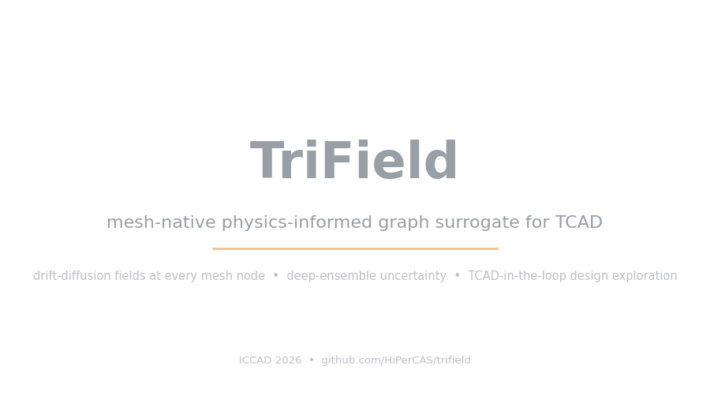
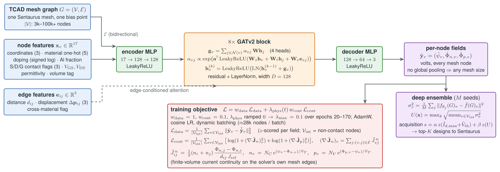

# TriField

**A neural network that gives the device simulator a head start.**

TriField is the code of our ICCAD 2026 paper (see [Citation](#citation)). It trains a graph neural
network on device simulations and uses its prediction as the starting point of the next simulation.
The simulator still computes the final answer, so the results are exactly the simulator's own; they
just arrive sooner.

## Motivation

Designing a transistor means trying many geometries and doping levels. Each candidate is checked with a
device simulator (TCAD; here Synopsys Sentaurus Device), which solves the semiconductor equations on a
3D mesh. That is accurate but slow: one multi-fin device takes minutes to hours, so exploring a design
space costs days of computing.

A neural network can predict the simulator's result in about a second, but only approximately. For
design decisions we want the simulator's exact numbers.

## Idea

Use the network to start the simulator, not to replace it.

1. **Predict.** A graph neural network runs directly on the simulator's mesh and predicts the
   simulator's solution (the electric potential and the electron and hole levels) at every mesh point.
2. **Polish.** A small solver in this package corrects the prediction on the simulator's own
   discretised equations, so that the simulator accepts it as a starting point.
3. **Finish.** Sentaurus starts from the polished prediction instead of from zero voltage and finishes
   the solve. The device metrics (maximum current Id,max, on-resistance Ron, threshold voltage Vth)
   come from Sentaurus.

We call this the **warm twin**. As a fair baseline, the **cold twin** computes the same bias points
without the network, each simulation starting from scratch. The **production flow** is how our
training data was generated: Sentaurus sweeps the voltages step by step.

The network is trained on simulations of earlier designs. **Active learning** picks which new designs to
simulate next, and every warm-twin run produces new training data.

<p align="center">
  
</p>

## Results

Test case: a multi-fin GaN/AlGaN tri-gate FinFET. Benchmark: 13 designs that were not used for training
(1-8 fins, 3k-22k mesh nodes), computing Id,max, Ron and Vth for each (meshing excluded). The warm and
cold twin were run back to back on each design.

| | median speedup vs production | range | total time (13 designs) | Id,max / Vth vs production |
|---|---|---|---|---|
| production flow | 1x | | 22.6 h | reference |
| cold twin (no network) | 1.4x | 0.6-11x | 16.5 h | < 1e-8 / <= 1.6 mV |
| **warm twin** | **20x** | 4.3-80x | **1.0 h** | < 1e-7 / <= 0.7 mV |

On each design the warm twin was a median 9.6x faster than the cold twin. Timings come from one shared
workstation and vary between runs: an earlier run of the same benchmark gave 12x (warm) and 1.8x (cold).
Five of the warm runs first shared a GPU with a training job and were repeated on an idle GPU; the
table uses the repeats.

Where the time goes: the network's prediction is close (about 0.15-0.2 V error in the potential on
unseen designs), and after polishing, Sentaurus converged directly from it at about 85% of the bias
points. Most of the remaining time is spent on the points where it did not (see
[Limitations](#limitations)).

## Running it

### Requirements

* Python >= 3.10 and [PyTorch](https://pytorch.org/get-started/).
* **Synopsys Sentaurus** with a licence (`sde`, `sdevice`, `tdx` on `PATH`).
* **`parameter.par`**, the material parameters. They come from the Synopsys material database and are
  not redistributed; build the file from your own installation as described in
  [`trifield/tcad/README.md`](trifield/tcad/README.md):
  ```bash
  DB=$STROOT/tcad/$STRELEASE/lib/sdevice/MaterialDB      # adjust to your install
  cat $DB/GaN.par $DB/AlN.par $DB/AlGaN.par > parameter.par
  ```
* A GPU is recommended for training and polishing (CUDA 13 for GPU polishing; otherwise it runs on
  the CPU).

The repository ships **code and the training recipe only**: no trained weights and no simulation data,
because both derive from the licensed simulator. You generate the data and train the network yourself.

### Install

```bash
git clone https://github.com/HiPerCAS/trifield.git
cd trifield
pip install -e ".[tcad,train]"        # or ".[tcad,train,gpu]" for GPU polishing (cupy, cuDSS, nvmath)
```

### Steps

[`examples/recipe.sh`](examples/recipe.sh) runs steps 2-5. Set `--workers` to the CPU cores and
licences you can use; every Sentaurus job is single-threaded.

```bash
# 1. Check the Sentaurus setup on one design (device metrics + field snapshots as graphs)
python -m trifield.tcad.simulation --design examples/design.json --par parameter.par \
    --work_dir runs --out_dir data/mine

# 2. Training data: about 100 random designs, simulated with the production flow
python -m trifield.tcad.campaign --par parameter.par --work_dir runs/train --out_dir runs/train_graphs \
    --fins 1 2 3 4 5 6 8 --n_per_fins 15 --keep --workers 16 --seed 42
python -m trifield.tcad.extract runs/train/sim_* --out_dir data/graphs --workers 16
python -m trifield.data.split data/graphs --train data/train --val data/val --val_frac 0.15

# 3. Train the networks of the ensemble (one per seed; checkpoints in checkpoints/ens/)
python -m trifield.train --data_dir data/train --val_data_dir data/val --epochs 35 \
    --input_norm --local_y --drop_vor --norm none --balance --gate_weight 8 --physics_max_weight 0 \
    --max_nodes_per_batch 40000 --grad_checkpoint --cache_data --weight_decay 1e-4 \
    --run_name ens --seed 0                # repeat with --seed 1, 2, ...
python -m trifield.evaluate --ckpts checkpoints/ens/last_seed*.pt --data_dir data/val

# 4. Warm twin on one design: prints each bias-point solve, then Id,max, Ron and Vth
python -m trifield.tcad.twin --design examples/design.json --par parameter.par \
    --ckpts checkpoints/ens/last_seed*.pt

# 5. Benchmark on fresh designs: warm and cold twin vs the production flow
python -m trifield.tcad.campaign --par parameter.par --work_dir runs/bench --out_dir runs/bench_graphs \
    --fins 1 2 4 6 8 --n_per_fins 3 --keep --workers 16 --seed 2026
python -m trifield.tcad.benchmark --runs runs/bench --ckpts checkpoints/ens/last_seed*.pt \
    --modes warm cold --device cuda --refine_device auto --refine_cap 30 --escalate \
    --out runs/bench_twin.csv

# 6. Active learning: score mesh-only candidates and pick the next designs to simulate
python -m trifield.tcad.campaign --par parameter.par --work_dir runs/cand --out_dir runs/cand_graphs \
    --fins 1 2 3 4 5 6 8 --n_per_fins 40 --mesh_only --keep --workers 16 --seed 7
python -m trifield.active_learning --ckpts checkpoints/ens/last_seed*.pt \
    --candidates runs/cand_graphs --train_designs data/train --top_k 16 --out_csv runs/selection.csv
```

## How it works

### The network

<p align="center">
  
</p>

* **Input.** The simulator's tetrahedral mesh as a graph: one node per mesh point (position, material,
  doping, Al mole fraction, contacts, applied gate and drain voltage, permittivity) and one edge per
  tetrahedron edge (length, direction, material boundary) (`trifield/data/graph_builder.py`).
* **Output.** At every node, the three quantities the simulator solves for: the electrostatic potential
  psi and the electron and hole quasi-Fermi potentials Phi_n and Phi_p.
* **Architecture.** Encoder, eight graph-attention (GATv2) layers, decoder; about 1.1 M parameters
  (`trifield/model.py`). There is no global pooling, so the same network serves meshes of any size.
  The figure shows the paper's version; the current recipe drops LayerNorm.
* **Ensemble.** Several networks trained with different seeds. Where they disagree, the prediction is
  less reliable; active learning uses this.

**Training objective.** The paper trained with an extra physics term (the current-continuity residual
of the predicted fields). The current recipe trains on data only (`--physics_max_weight 0`), with the
loss balanced across materials and fields (`--balance`) and extra weight next to the gate oxide
(`--gate_weight 8`), because on the same data it gave much more accurate fields. RMSE in volts on our
validation set (480 snapshots) and on 10 designs outside the training data:

| recipe | psi / Phi_n / Phi_p, validation | psi / Phi_n / Phi_p, 10 unseen designs |
|---|---|---|
| paper, with physics term (weight 0.1), 1 network | 1.25 / 1.10 / 0.55 | 1.27 / 1.02 / 0.49 |
| paper, data only, 1 network | 0.73 / 0.72 / 0.71 | 0.47 / 0.48 / 0.49 |
| current recipe, 1 network | 0.25 / 0.25 / 0.22 | 0.20 / 0.18 / 0.24 |
| current recipe + active learning (2 rounds), 3 networks | 0.22 / 0.22 / 0.19 | 0.15 / 0.14 / 0.21 |

The physics term is still available (`--physics_max_weight`, `--poisson_weight`). We did not compare the
two recipes inside the warm twin, nor re-test the paper's finding that the physics term helps when
extrapolating to much larger arrays (38 fins).

### Polishing the prediction

Sentaurus does not converge from the raw prediction: in our first benchmark only 9 of 111 bias points
did. `trifield.physics` therefore rebuilds the simulator's discretised equations from two short
per-mesh exports, and corrects the prediction with a few damped Newton iterations (capped at 30). On
Sentaurus' own solutions the rebuilt equations hold to a relative residual of about 1e-11. The
polishing runs on the GPU (cuDSS with two-sided scaling, needed for these badly scaled systems) or on
the CPU (SuperLU); `--refine_device auto` picks the CPU below 10k mesh nodes. Details:
[`trifield/physics/README.md`](trifield/physics/README.md).

If Sentaurus still fails from the polished prediction, the twin tries, in order: the nearest
converged bias point of the same design as the starting point, more polishing, a voltage ramp from that
neighbour, and finally a start from scratch. The threshold-voltage search steps in 0.5 V increments to
a tight bracket around Vth.

### Active learning

`trifield.active_learning` scores candidate designs (meshing takes seconds, no simulation) on four
criteria: ensemble disagreement, distance to the training designs, expected device performance, and
cost (mesh size). It selects either the Pareto ranking of these criteria (`--strategy pareto`) or a
weighted sum (`--strategy scalar`), with a diversity filter. The selected designs are simulated by the
warm twin itself, and every converged warm solve becomes a training example.

In our study on a 300-design pool, compared with a control fine-tuned for the same number of epochs
without new data (paired over 10 held-out designs, 95% bootstrap intervals):

| new training data | psi error vs control |
|---|---|
| 10 random designs | -1.5% [-4.4, +1.8] (not significant) |
| 10 designs, weighted-sum selection | -5.1% [-8.3, -2.1] |
| 32 designs, new examples weighted 4x | -13.1% [-18.6, -7.7] |
| 44 more designs (second round) | a further -3.7% [-7.0, -0.6] |

Ensemble disagreement ranked the per-snapshot error on unseen designs with Spearman 0.89. The more
accurate networks did not change how often Sentaurus converged directly from the polished prediction
(84%, 87%, 85% after 0, 1, 2 rounds).

### Limitations

* At strongly negative gate voltages (Vg <= -2 V at Vd = 12 V) of normally-on devices, Sentaurus
  usually does not converge from the polished prediction, and the twin falls back to voltage ramps,
  which are slow. On our held-out designs these were about 11% of the bias points but about half of
  the Sentaurus time.
* Results are for one device family and one simulator version (Sentaurus V-2024.03).

## Repository layout

```
trifield/                the Python package
  model.py               the graph neural network
  train.py, losses.py    training and loss terms
  evaluate.py            field error of trained networks
  inference.py           loading networks, ensemble prediction
  active_learning.py     choosing the next designs to simulate
  params.py              design space of the test case
  data/                  simulator output -> graphs, dataset, train/validation split
  physics/               the simulator's discretised equations and the polishing solver
  tcad/                  Sentaurus templates, single runs, campaigns, the twin, the benchmark
examples/                recipe.sh (whole pipeline), design.json (one design)
assets/                  figures
```

Design space of the test case (`trifield/params.py`): GaN thickness 10-100 nm, AlGaN thickness
10-100 nm, fin width 80-250 nm, oxide thickness 5-25 nm, gate thickness 5-40 nm, AlGaN doping
1e19-1e20 cm^-3, 1-8 fins.

## Citation

```bibtex
@inproceedings{popryho2026trifield,
  title     = {Mesh-Native Physics-Informed Graph Surrogates for {TCAD}-in-the-Loop Design Space Exploration},
  author    = {Popryho, Leonid and Sadeghi, Ayoub and Partin-Vaisband, Inna},
  booktitle = {Proceedings of the IEEE/ACM International Conference on Computer-Aided Design (ICCAD)},
  year      = {2026},
  doi       = {10.1145/3831252.3834249}
}
```

## License and acknowledgements

BSD 3-Clause, see [LICENSE](LICENSE). Developed at the High-Performance Circuits and Systems Laboratory
(HiPerCAS), University of Illinois Chicago.

This work was supported by the Center for Heterogeneous Integration of Micro Electronic Systems (CHIMES),
one of seven centers in the Joint University Microelectronics Program (JUMP) 2.0, a Semiconductor Research
Corporation (SRC) program sponsored by the Defense Advanced Research Projects Agency (DARPA), under Grant
2023-JU-3136. The authors thank Prof. Debjit Pal for providing the distributed simulation infrastructure
used in this work.

Sentaurus is a product of Synopsys, Inc.; this repository contains no Synopsys software, material data,
simulation results or weights trained on them.
