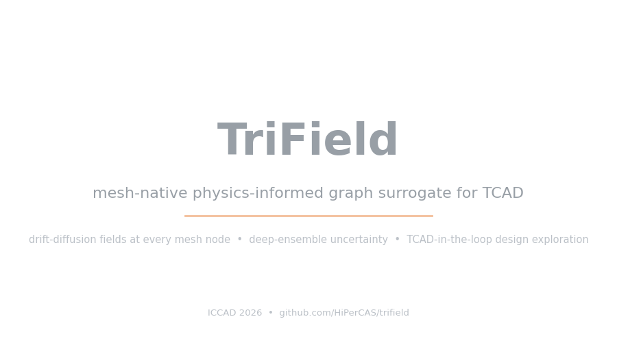
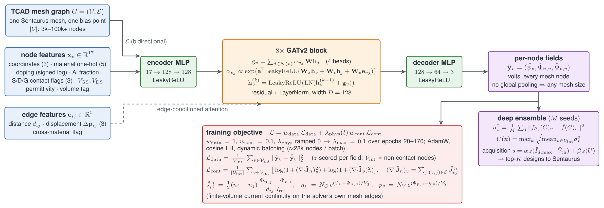

# TriField

**Mesh-native graph surrogates for TCAD, used as a warm start for the simulator.**

TriField is the code of our ICCAD 2026 paper (see [Citation](#citation)) on graph neural network
surrogates for Synopsys Sentaurus Device. A graph attention network runs **directly on the simulator's
tetrahedral mesh** and predicts the three drift-diffusion unknowns at every mesh vertex: the electrostatic
potential psi and the electron and hole quasi-Fermi potentials Phi_n and Phi_p.

Beyond the paper, the repository adds a **warm-start digital twin**: the surrogate's prediction, refined
on the simulator's own discretised equations, is handed to Sentaurus as the starting point of its solve.
Sentaurus then finishes the solve itself, so the device metrics (Id,max, Ron, Vth) are computed by the
simulator, not by the network. In our benchmark they matched the production flow (Id within 2e-8
relative, Vth within 2 mV), while the computation took a fraction of the time.

On 13 designs of a multi-fin GaN/AlGaN tri-gate FinFET (1-8 fins, 3k-22k mesh nodes) that were not used
for training, computing Id,max, Ron and Vth the same way the production flow does (meshing excluded):

| | median speedup vs production | range | total wall time (13 designs) | Id,max / Vth error |
|---|---|---|---|---|
| production Sentaurus flow | 1x | | 22.6 h | reference |
| cold twin | 1.8x | 0.8-14x | 12.6 h | < 1e-8 / <= 2 mV |
| warm twin | 12.1x | 2.4-52x | 1.9 h | < 2e-8 / <= 2 mV |
| warm twin, current defaults (later run) | 13.7x | 4.7-85x | 1.1 h | < 1e-8 / <= 0.7 mV |

The cold and warm rows were measured back to back on each design (`trifield.tcad.benchmark --modes warm
cold`): the warm twin was a median 4.0x faster than the cold twin. The last row is a later warm-only run
with the current default settings, on the same machine under heavier load from other jobs, compared with
the same cold and production times. All timings come from one shared workstation and vary between runs.

<p align="center">
  
</p>

The repository ships **code and the training recipe only**: no trained weights and no simulation data,
because both are derived from the licensed simulator and its material database. Reproducing the results
needs a Sentaurus licence; the surrogate itself runs anywhere PyTorch does.

## Terms in plain English

| term | meaning |
|---|---|
| TCAD, Sentaurus Device | Software that simulates a transistor by solving the semiconductor equations on a 3D mesh. Accurate, but a single device can take minutes to hours. |
| drift-diffusion fields (psi, Phi_n, Phi_p) | The three unknowns the simulator solves for at every mesh point: the electric potential and the "levels" of electrons and holes. Everything else (currents, charges) follows from them. |
| surrogate | A neural network trained on simulator results that predicts the same fields in about a second, but only approximately. |
| bias point | One pair of applied voltages (gate voltage Vg, drain voltage Vd) at which the device is solved. |
| Id,max, Ron, Vth | The device metrics we optimise: maximum drain current, on-resistance, and threshold voltage (the gate voltage at which the transistor turns on; here: where the current reaches 1 mA/mm at Vd = 12 V). |
| production flow | The reference way of getting these metrics: Sentaurus sweeps the voltages step by step from zero, as in our original data generation. |
| Newton steps | The simulator solves the equations iteratively; each iteration is a Newton step. A good starting point needs few steps, a bad one many, or the solve fails. |
| cold twin | Our streamlined simulation of only the bias points the metrics need, each started from scratch (zero applied voltage) and ramped to the target. No machine learning involved; it is the fair baseline. |
| warm start | Starting the simulator from a predicted solution instead of from scratch. |
| warm twin | The same bias points as the cold twin, but each simulation starts from the surrogate's prediction after refinement. The simulator still produces the final answer, so the metrics are the simulator's own. |
| refinement | A small solver in this package that corrects the surrogate's prediction using the simulator's own discretised equations, so that the simulator accepts it as a starting point. Runs on the GPU or CPU in seconds to a few minutes. |
| fallback | What the warm twin does when a warm start fails: it tries a neighbouring converged solution, then more refinement, then ramps from a neighbouring point, and only then starts from scratch. |
| ensemble, uncertainty | Several independently trained networks; where they disagree, the prediction is less trustworthy. Used to pick which new designs to simulate (active learning). |
| normally-on device, deep off-state | A device that still conducts at Vg = -6 V. Its strongly negative gate voltages (deep off-state) are the hardest bias points for the warm start. |

## How the warm twin works

The ensemble predicts psi with about 0.15-0.2 V RMSE on designs it was not trained on. That is a good
field picture, but Sentaurus did not converge from the raw prediction: in our first benchmark only 9 of
111 bias points converged directly, and the warm twin was no faster than the cold twin. Three pieces
changed that in our measurements:

1. **Refinement on the simulator's discretised equations** (`trifield.physics`). The Sentaurus deck's
   discrete equations are rebuilt from two short per-mesh exports (box coefficients, material
   constants) and solved from the surrogate guess with damped Gummel iterations and a joint
   (psi, Phi_n) Newton, capped at 30 iterations. On Sentaurus' own on-state solutions the rebuilt
   Poisson and electron equations hold to a median relative residual of ~1e-11 or better. After refinement, about 85% of the
   135 bias points of 10 held-out designs converged directly in Sentaurus, in a median of 9 Newton steps.
2. **An accurate GPU solver.** The linear systems span ~1e-50..1e+10; the GPU direct solver (cuDSS)
   needs two-sided (Ruiz) equilibration, otherwise its solutions were wrong and the refined guesses
   diverged in Sentaurus. With it, refinement on one 25k-node design took 21 s on the GPU against 360 s on
   the CPU. Moving refinement to the GPU took the warm twin from about 4.5x to 12x faster than production
   in our benchmarks.
3. **Fallbacks that avoid starting from scratch.** If a direct warm solve fails, the twin tries the
   nearest converged solution of the same design as the starting point, then refines further, then ramps
   Sentaurus from its nearest converged bias point, and only then starts from scratch. The threshold
   search steps from 0 V in 0.5 V increments to a tight bracket around Vth instead of jumping to strongly
   negative gate voltages, which are the slowest points.

Known limitation: at strongly negative gate voltages (Vg <= -2 V at Vd = 12 V) of normally-on devices,
warm starts usually fail and the twin falls back to ramps, which are slow. On our held-out pool designs
these points were about 11% of the bias points but about half of the Sentaurus time. See
[`trifield/physics/README.md`](trifield/physics/README.md), "Known floors and caveats".

## What's included

| Capability | Entry point |
|---|---|
| **Warm-start digital twin** for one design (Id,max, Ron, Vth) | `python -m trifield.tcad.twin` · `trifield.tcad.twin.Twin` |
| **Twin vs production benchmark** (warm and/or cold, paired) | `python -m trifield.tcad.benchmark` |
| **Discretised equations + refinement** (CPU or GPU) | `trifield.physics` · [`trifield/physics/README.md`](trifield/physics/README.md) |
| **Surrogate training** (ensemble members, loss balancing, optional continuity / Poisson residuals) | `python -m trifield.train` |
| **Evaluation** (per-field RMSE per fin count, residuals) | `python -m trifield.evaluate` |
| **Active learning** (uncertainty, novelty, objective, cost; Pareto or weighted-sum selection) | `python -m trifield.active_learning` |
| **Sentaurus pipeline** (structure + mesh, production runs, campaigns, TDR to graphs) | `trifield.tcad` · [`trifield/tcad/README.md`](trifield/tcad/README.md) |
| **End-to-end recipe** (data, ensemble, twin benchmark, acquisition) | [`examples/recipe.sh`](examples/recipe.sh) |

## Installation

Requires Python >= 3.10. Install [PyTorch](https://pytorch.org/get-started/) for your platform first, then:

```bash
git clone https://github.com/HiPerCAS/trifield.git
cd trifield
pip install -e ".[tcad,train]"        # + ".[gpu]" for GPU refinement (CUDA 13: cupy, cuDSS, nvmath)
```

`torch-geometric`'s pure-PyTorch scatter is used throughout (no compiled extensions). The twin needs
Sentaurus (`sde`, `sdevice`, `tdx` on `PATH`) and the material parameter file, which is **not**
redistributed: [`trifield/tcad/README.md`](trifield/tcad/README.md) explains how to assemble it from
your installation.

## Recipe

[`examples/recipe.sh`](examples/recipe.sh) runs the whole pipeline. The steps:

```bash
# 1. Training data: production solves of random designs, graphs at the output-curve biases + transfer curve
python -m trifield.tcad.campaign --par parameter.par --work_dir runs/train --out_dir runs/train_graphs \
    --fins 1 2 3 4 5 6 8 --n_per_fins 15 --keep --workers 16
python -m trifield.tcad.extract runs/train/sim_* --out_dir data/graphs
python -m trifield.data.split data/graphs --train data/train --val data/val --val_frac 0.15

# 2. Ensemble members (one per seed / GPU)
python -m trifield.train --data_dir data/train --val_data_dir data/val --epochs 35 \
    --input_norm --local_y --drop_vor --norm none --balance --gate_weight 8 --physics_max_weight 0 \
    --max_nodes_per_batch 40000 --grad_checkpoint --cache_data --run_name ens --seed 0

# 3. Twin for one design, and the paired benchmark against production runs
python -m trifield.tcad.twin --design examples/design.json --par parameter.par \
    --ckpts checkpoints/ens/last_seed*.pt
python -m trifield.tcad.benchmark --runs runs/bench --ckpts checkpoints/ens/last_seed*.pt \
    --modes warm cold --device cuda --refine_device auto --refine_cap 30 --escalate
```

The twin solves the bias points the metrics need (Id,max at (Vg11, 12 V), Ron at (Vg11, 3 V), and the
points of the Vth search at Vd = 12 V), each as an independent warm solve, several in parallel.

## Model

<p align="center">
  
</p>

*The paper's model and training objective (PI-GNN), rendered from [`assets/architecture.tex`](assets/architecture.tex)
with `assets/build_architecture.sh`. The current recipe uses the same network without LayerNorm and trains
without the physics term (see "Physics loss or not" below).*

* **Mesh graph.** Nodes are the mesh vertices with 17 features: normalised coordinates, a material
  one-hot over {GaN, AlGaN, Au, HfO2, TiN}, signed-log doping, Al mole fraction, source/drain/gate
  contact flags, the applied Vg and Vd, the relative permittivity and a volume tag. Edges are the six
  vertex pairs of every tetrahedron, stored in both directions, with the distance, the displacement
  vector and a cross-material flag (`trifield/data/graph_builder.py`).
* **Network.** Encoder MLP, eight edge-conditioned GATv2 blocks (4 heads, residual), decoder MLP;
  about 1.1 M parameters (`trifield/model.py`). Per-node output with no readout, so one set of weights
  serves meshes of any size (here 1-8 fins, 3k-65k nodes).
* **Objective.** Per-field z-scored MSE with learned weights per (material, field) (`--balance`), and an
  extra weight on semiconductor nodes next to the gate oxide (`--gate_weight`). The paper's
  finite-volume current-continuity and Poisson residuals are available as extra terms
  (`--physics_max_weight`, `--poisson_weight`).
* **Ensemble.** Independently seeded members; their per-node disagreement is the uncertainty used for
  active learning.

**Physics loss or not.** The paper trained with the continuity residual (PI-GNN). The current recipe
trains on data only (`--physics_max_weight 0`) because, on the same data, it gave much more accurate
fields. RMSE in volts over all mesh nodes, on our validation set (480 snapshots) and on 10 pool designs
outside the training data:

| recipe | psi / Phi_n / Phi_p, validation | psi / Phi_n / Phi_p, 10 unseen designs |
|---|---|---|
| paper, physics-informed (continuity weight 0.1), 1 model | 1.25 / 1.10 / 0.55 | 1.27 / 1.02 / 0.49 |
| paper, data-only ablation, 1 model | 0.73 / 0.72 / 0.71 | 0.47 / 0.48 / 0.49 |
| current recipe, 1 model | 0.25 / 0.25 / 0.22 | 0.20 / 0.18 / 0.24 |
| current recipe + twin-labelled data (2 rounds), 3-model ensemble | 0.22 / 0.22 / 0.19 | 0.15 / 0.14 / 0.21 |

The first two rows were trained for 60 epochs on our training set; the current recipe used a slightly
larger training set (35 epochs). We did not compare physics-informed and data-only models inside the warm
twin, nor re-test the paper's finding that the physics loss helps when extrapolating to much larger
arrays (38 fins) with the current recipe.

## Active learning

`trifield.active_learning` scores mesh-only candidates (meshing takes seconds, no solve) on ensemble
uncertainty, novelty (distance to the training designs), a device-objective estimate, and cost (mesh
size), and selects either the NSGA-II ranking of these criteria (non-dominated sorting plus crowding
distance, `--strategy pareto`) or a weighted sum (`--strategy scalar`), with a diversity filter. Selected
designs can be **labelled by the twin itself**: every converged warm solve is a Sentaurus solution and
becomes a training graph.

In our study on a 300-design pool (1-5 fins), with study scripts that are not part of this package,
twin-labelled data improved the fields on 10 held-out pool designs, compared with a control fine-tuned
for the same epochs without new data (paired per design, 95% bootstrap intervals over the 10 designs):

| new training data | psi RMSE vs control |
|---|---|
| 10 random designs | -1.5% [-4.4, +1.8] (not significant) |
| 10 designs, weighted-sum selection | -5.1% [-8.3, -2.1] |
| 32 twin-labelled designs, new graphs weighted 4x | -13.1% [-18.6, -7.7] |
| 44 designs (second round) | a further -3.7% [-7.0, -0.6] |

Other measured findings: ensemble disagreement ranked per-snapshot error on unseen designs with
Spearman 0.89; the gate-oxide weighting (`--gate_weight 8`) reduced the off-state error next to the gate
oxide by 14% (3 seeds); twin labelling took 5-25 min for most designs and up to a few hours for
normally-on devices. The better fields did not measurably change how often warm starts converge directly
(84%, 87%, 85% after 0, 1, 2 rounds).

## Sentaurus pipeline

`trifield/tcad/` contains the Sentaurus Structure Editor script of the multi-fin GaN/AlGaN tri-gate
FinFET, the two Sentaurus Device command files of the production flow (Id-Vd corner sweep with nine
field snapshots; backward Vg sweep for Vth), the twin, a design driver, a parallel campaign script, the
benchmark, and the TDR-to-graph conversion (`tdx` to DF-ISE text, then a pure-Python parser).

Design space of the test case (`trifield/params.py`): GaN thickness 10-100 nm, AlGaN thickness
10-100 nm, fin width 80-250 nm, oxide thickness 5-25 nm, gate thickness 5-40 nm, AlGaN doping
1e19-1e20 cm^-3, 1-8 fins.

## Citation

```bibtex
@inproceedings{popryho2026trifield,
  title     = {Mesh-Native Physics-Informed Graph Surrogates for {TCAD}-in-the-Loop Design Space Exploration},
  author    = {Popryho, Leonid and Sadeghi, Ayoub and Partin-Vaisband, Inna},
  booktitle = {Proceedings of the IEEE/ACM International Conference on Computer-Aided Design (ICCAD)},
  year      = {2026},
  doi       = {10.1145/3831252.3834249}
}
```

## License and acknowledgements

BSD 3-Clause, see [LICENSE](LICENSE). Developed at the High-Performance Circuits and Systems Laboratory
(HiPerCAS), University of Illinois Chicago.

This work was supported by the Center for Heterogeneous Integration of Micro Electronic Systems (CHIMES),
one of seven centers in the Joint University Microelectronics Program (JUMP) 2.0, a Semiconductor Research
Corporation (SRC) program sponsored by the Defense Advanced Research Projects Agency (DARPA), under Grant
2023-JU-3136. The authors thank Prof. Debjit Pal for providing the distributed simulation infrastructure
used in this work.

Sentaurus is a product of Synopsys, Inc.; this repository contains no Synopsys software, material data,
simulation results or weights trained on them.
